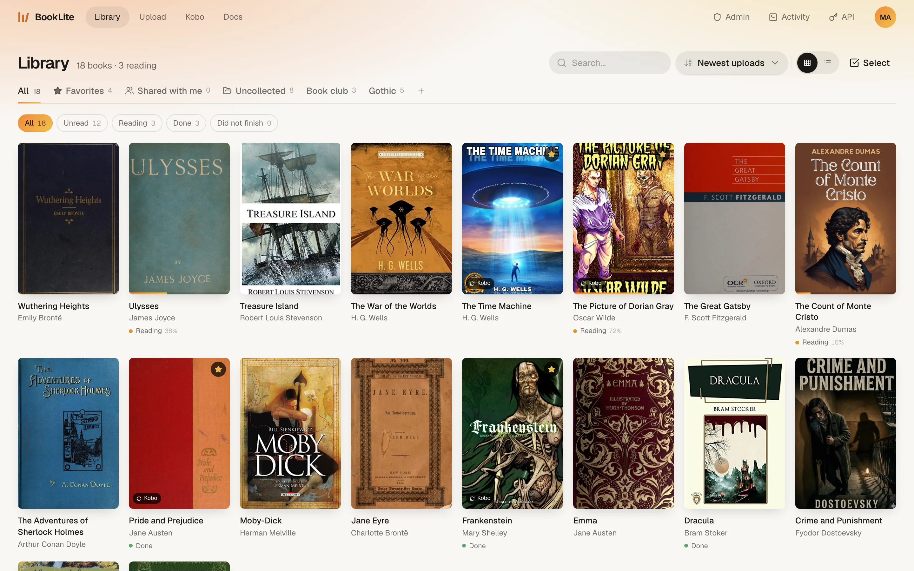

#  BookLite

<picture>
  <source media="(prefers-color-scheme: dark)" srcset="docs/screenshot-dark.webp" />
  
</picture>

BookLite is a self-hosted ebook library for a personal or family bookshelf. Upload books, enrich their metadata from several providers, read in the browser, share books between users and sync selected books to Kobo.

It is inspired by [BookLore](https://github.com/booklore-app/booklore), but keeps a tighter scope: no OPDS feeds, no KOReader sync, no comics or audiobooks and no BookDrop-style ingestion pipeline.

## Features

### Library and reading

- Upload `EPUB`, `KEPUB` and `PDF`
- Grid and list views with sorting, full-text search (SQLite FTS5) and reading status filters
- Custom collections plus built-in `Favorites`, `Shared with me` and `Uncollected`
- Browser reader for `EPUB` and `KEPUB` with paper, sepia and night themes, font choice and font size
- Reading status and progress tracking
- Per-book metadata editing, cover changes, downloads and deletion
- Light and dark mode, with a personal accent color per user

### Uploads

- Drag-and-drop multi-file uploads
- Background import jobs with live progress
- Filename parsing before import, with optional OpenRouter-assisted cleanup for messy filenames
- Metadata preview while reviewing uploads; manual edits to title, author and description are kept
- Assign collections and favorites before the import finishes

### Metadata

- 7 providers: Open Library, Google Books, Amazon, bol.com, Hardcover, Goodreads and Douban
- Owners enable or disable providers per instance
- Results are merged field by field instead of trusting a single source
- Covers are ranked separately and can be changed later from the book drawer
- Optional OpenRouter resolver normalizes results, rejects wrong matches and fills in missing series data

### Users and administration

- `OWNER` and `MEMBER` roles
- Share books directly between users
- Owner-only user management, provider settings, upload limits and diagnostics
- Impersonate members for support and debugging
- Activity log for auth, upload, metadata and Kobo events
- LLM-ready API docs with expiring, admin-generated tokens
- Optional external ebook download link in the header

### Kobo sync

- Built-in Kobo-compatible API endpoint
- Sync all books or only selected collections
- Reading progress sync, latest timestamp wins
- Only `EPUB` and `KEPUB` sync; `PDF` stays library-only
- New accounts start with Kobo sync on and `Favorites` selected

## Quick start

### Docker Compose

```bash
cp .env.example .env
# set JWT_SECRET in .env
docker compose up -d --build
```

Open [http://localhost:6060](http://localhost:6060).

The port is published on `127.0.0.1` by default. Put a reverse proxy in front of it, or set `PUBLISH_ADDRESS=0.0.0.0` to reach it from other machines.

### Prebuilt image

```bash
docker run -d \
  --name booklite \
  -p 127.0.0.1:6060:6060 \
  -e JWT_SECRET=replace-with-a-long-random-secret \
  -e BASE_URL=http://localhost:6060 \
  -v "$(pwd)/app-data:/app/data" \
  -v "$(pwd)/books:/books" \
  ghcr.io/marijnbent/booklite:latest
```

Database migrations run automatically on startup.

### First run

Open `/setup` and create the owner account, or set these before the first start:

- `BOOTSTRAP_OWNER_EMAIL`
- `BOOTSTRAP_OWNER_USERNAME`
- `BOOTSTRAP_OWNER_PASSWORD`

## Configuration

[`.env.example`](.env.example) is the starting point. Most provider toggles and AI settings can also be changed later under `Admin`.

Core:

| Variable | Default | Notes |
| --- | --- | --- |
| `JWT_SECRET` | | Required. Must not be empty or the example value. |
| `PORT` | `6060` | |
| `HOST` | `0.0.0.0` | |
| `BASE_URL` | `http://localhost:6060` | Public URL, used for Kobo endpoints |
| `ACCESS_TOKEN_TTL_SECONDS` | `3600` | |
| `REFRESH_TOKEN_TTL_SECONDS` | `7776000` | |
| `UPLOAD_LIMIT_MB` | `100` | |

Storage and frontend:

| Variable | Default | Notes |
| --- | --- | --- |
| `APP_DATA_DIR` | `/app/data` | Database, covers and temp files |
| `BOOKS_DIR` | `/books` | Book files |
| `PUBLISH_ADDRESS` | `127.0.0.1` | `compose.yml` only. Host address the port is published on. |
| `APP_DATA_BIND` | `./app-data` | `compose.yml` only |
| `BOOKS_BIND` | `./books` | `compose.yml` only |
| `WEB_DIST_DIR` | | Override for built frontend assets |
| `BOOKLITE_FRONTEND_MODE` | `auto` | `auto`, `vite`, `static` or `off` |

Metadata (all optional):

| Variable | Notes |
| --- | --- |
| `AMAZON_BOOKS_DOMAIN` | Default `com` |
| `AMAZON_BOOKS_COOKIE` | |
| `GOOGLE_BOOKS_LANGUAGE` | For example `en` |
| `GOOGLE_BOOKS_API_KEY` | |
| `HARDCOVER_API_KEY` | |
| `OPENROUTER_API_KEY` | Enables metadata AI. Read from the environment only, never stored. |

Metadata AI uses `~openai/gpt-luna-latest` by default. Owners can pick a different OpenRouter model in `Admin`. Installs still on the old `openai/gpt-5.6-luna` default move to the new alias on startup; other saved choices are kept.

## Kobo setup

1. Open the `Kobo` page in BookLite and pick which collections to sync.
2. Connect the Kobo by USB and open `.kobo/Kobo/Kobo eReader.conf`.
3. Replace the `api_endpoint=` line with the full line from the `Kobo` page.
4. Eject and sync on the Kobo.

Regenerating the Kobo token invalidates the previous endpoint.

## Development

Requires Node.js 22 or 24.

```bash
npm install
npm run db:migrate
npm run dev
```

The app runs at `http://localhost:6060`, with the API and Vite served from one process. Run `npm run db:migrate` again after pulling schema changes.

Other modes:

```bash
npm run dev:split    # API and Vite as separate processes
npm run docker:dev   # dev setup in Docker
```

Checks:

```bash
npm run build
npm run typecheck
npm test
```

Database helpers: `npm run db:generate`, `npm run db:migrate`, `npm run db:studio`.

The shared logo is `apps/web/public/logo.svg`. After changing it, run `npm run generate:icons` to refresh the browser, app and repository icons.

### Stack

- Backend: Fastify, TypeScript, Drizzle and SQLite (WAL)
- Frontend: React, Vite, TanStack Query and dnd-kit
- Runtime: a single Docker container

### Layout

- `apps/api`: Fastify API
- `apps/web`: React app
- `packages/shared`: shared TypeScript contracts
- `docs`: README screenshots
